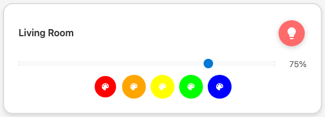
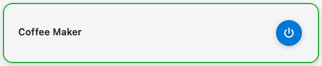
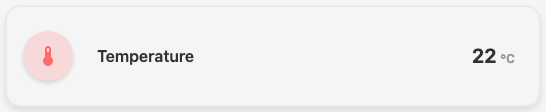
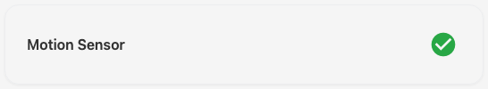
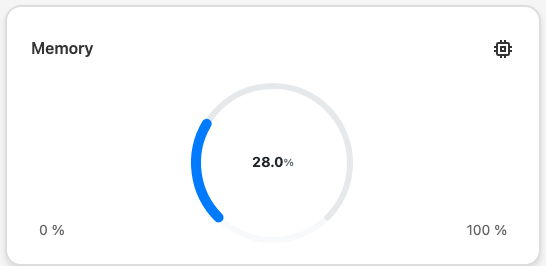
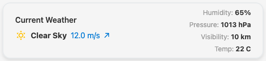
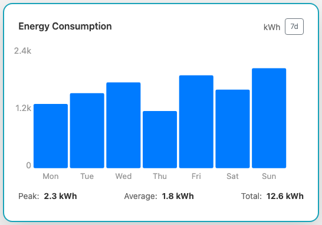
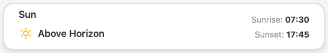
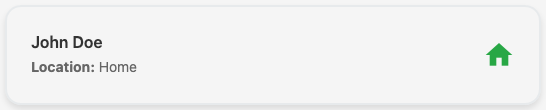

# Home Assistant Dashboard

A visual dashboard designer for Home Assistant. Home Assistant remains the backend for your entities, automations, integrations, and services; this app replaces the Lovelace dashboard experience with a focused editor and a curated set of built-in cards. Design views visually, connect them to your HA entities, and avoid the recurring work of installing and repairing separate community Lovelace cards.

## Examples

| Light Control                     | Switch Control                      | Sensor Display                          |
| --------------------------------- | ----------------------------------- | --------------------------------------- |
|  |  |  |

| Binary Sensor                                    | Gauge                                 | Weather                            |
| ------------------------------------------------ | ------------------------------------- | ---------------------------------- |
|  |  |  |

| Energy Chart                     | Sun Info                   | Person Location                       |
| -------------------------------- | -------------------------- | ------------------------------------- |
|  |  |  |

Demo is available here: https://mp-se.github.io/ha-dashboard/

## ✨ Features

- **Visual-first dashboard design**: Create, organize, and edit views, entities, and components in the built-in editor; JSON is available for advanced configuration and backup
- **Guided first run**: A short setup guide routes new users to HA connection, view creation, and the entity or built-in card palettes
- **Starter layouts**: Begin with a one-page, rooms, or home-systems structure; layouts use built-in cards and contain no assumed entity IDs
- **Safer editing**: Undo/redo, duplicate cards, a visible unsaved-changes state, discard-to-saved, and authenticated restore of saved dashboard versions
- **Device previews**: Check dashboard card layouts at desktop, tablet, and phone widths while editing
- **Dashboard checks**: Review configuration errors and, when connected, entity references that Home Assistant cannot find
- **Real-time Updates**: WebSocket connection with automatic reconnection and exponential backoff
- **Area Organization**: View devices and entities grouped by Home Assistant areas with virtual area entities
- **Curated built-in cards**: Card implementations ship with the app, so there are no separately installed Lovelace card packages to keep upgrading
- **Flexible Entity Specification**: Direct references, wildcard patterns, or custom getter functions
- **Device & Area Support**: Browse devices organized by area, filter entities by area, view area entity mappings
- **Room Cards**: Advanced HaRoom component with temperature/humidity display, multi-entity controls (up to 3), and domain-specific colors
- **Responsive Design**: Dark mode support with mobile-optimized layout
- **PWA Support**: Install as a native app on any device
- **Offline Fallback**: Service worker enables offline access with cached data
- **LAN-friendly security**: HTTPS and password-protected editor/configuration access for self-hosted deployments
- **Extensible**: Component-based architecture for easy customization
- **Error Resilience**: Network failures don't break the UI; connection status always visible
- **Robust Configuration**: Detailed JSON error reporting with line/column context for malformed configs

## 🎨 Card Types

The dashboard includes 26 built-in card types, maintained as part of this app:

**Entity Controls**: Lights, Switches, Buttons, Select, Media Player
**Displays**: Sensors, Binary Sensors, Gauges, Chips, Text, Links, Images
**Information**: Weather, Sun, Person, Energy, Alarms, Printers
**Layout**: Spacers, Headers, Rows
**Advanced**: Sensor graphs, Entity lists, Custom getters

## 🚀 Quick Start

### 1. Prerequisites

- Docker and Docker Compose (or a Node.js version supported by the current Vite toolchain for development)
- Home Assistant instance with a long-lived access token
- Sign-in password set with `VIEWER_PASSWORD` (required), and optionally a separate `EDITOR_PASSWORD` for editing (see [Installation](./INSTALL.md))

### 2. Configure the Dashboard

For a first launch, set `VIEWER_PASSWORD`, `HA_URL` and `HA_ACCESS_TOKEN` in `.env` and an initial view in `data/dashboard-config.json`. After signing in, use the visual editor to build and refine the dashboard. The HA token is a Home Assistant credential; the editor password is separate and protects access to the dashboard configuration.

Example bootstrap configuration:

```json
{
  "app": {
    "title": "My Dashboard",
    "developerMode": false,
    "localMode": false
  },
  "haConfig": {
    "haUrl": "https://your-ha-instance:8123",
    "accessToken": "your-long-lived-token-here"
  },
  "views": [
    {
      "name": "overview",
      "label": "Overview",
      "icon": "mdi mdi-view-dashboard",
      "entities": [
        { "entity": "light.living_room" },
        { "entity": "sensor.temperature_*" }
      ]
    }
  ]
}
```

### 3. Deploy with Docker

```bash
docker-compose up -d
```

Access at `https://localhost:8443` (or your configured LAN hostname), then sign in with the editor password. The app connects to Home Assistant for live states and service calls; it does not replace Home Assistant itself.

## 📖 Documentation

- **[Installation & Deployment](./INSTALL.md)** — Docker setup, certificate generation, Portainer configuration
- **[Migration Guide](./MIGRATION.md)** — Upgrading to v0.9.0: environment variables, API-only serving, Docker changes
- **[Configuration Guide](./CONFIGURATION.md)** — JSON schema, all card types, entity specification methods, areas & devices, examples

## 🔒 Security Notes

- The editor password protects access to the dashboard configuration; it is distinct from the Home Assistant long-lived token
- The server config is not served as a public static file. Browser-cached dashboard configuration is read-only when the server is unavailable; HA credentials are stored separately by the browser app
- Keep real tokens and passwords out of source control, and use HTTPS even on a trusted LAN
- Self-signed certificates require installation on client devices for PWA access
- Home Assistant token should be long-lived; rotate periodically in HA

## 🛠️ Development

```bash
npm install
npm run dev
```

App runs at `http://localhost:5173` with hot reload enabled.

## 📦 Project Structure

```
.
├── data/dashboard-config.json    # Main configuration file
├── src/
│   ├── components/                      # Card components
│   ├── stores/                          # Home Assistant and dashboard state
│   └── App.vue                          # Root component
├── docker/
│   ├── Dockerfile
│   ├── nginx.conf
│   └── ssl/                             # Certificates & generation script
└── package.json
```

## 🐛 Troubleshooting

See [INSTALL.md](./INSTALL.md) for deployment issues and [CONFIGURATION.md](./CONFIGURATION.md) for configuration problems.

## 📝 License

See LICENSE file for details.
